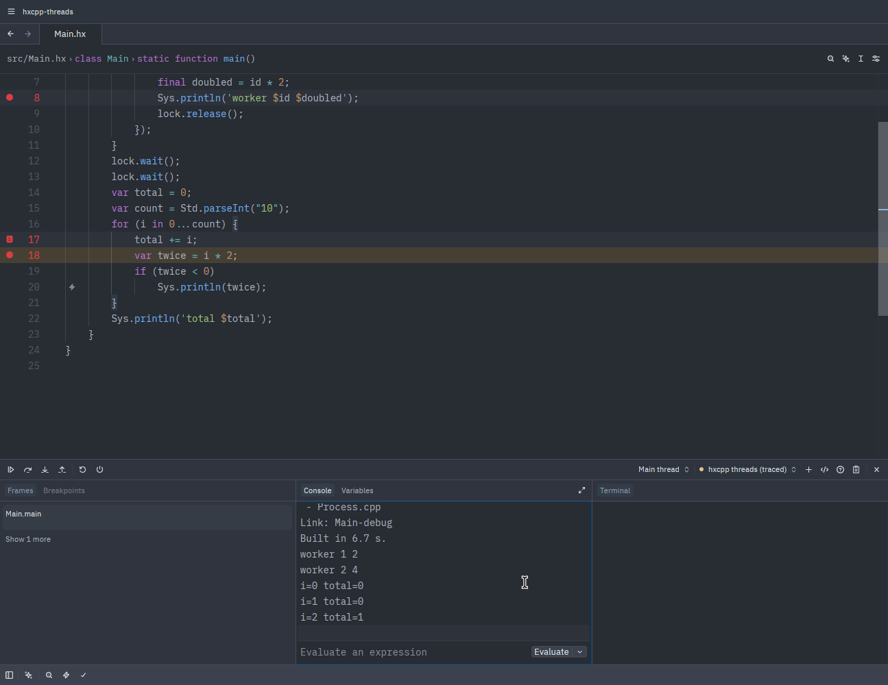

# Haxe Debugger for Zed

Breakpoints, stepping, variables and a debug console for Haxe in [Zed](https://zed.dev): eval
(`--interp` and macros), hxcpp, cppia, HashLink and JavaScript, plus Lime, OpenFL, Flixel and Ceramic
projects, which need no configuration at all.



- **One debugger for every target.** The build's output picks the debugger: `--interp` runs in eval,
  `--cpp` in hxcpp, `--hl` in HashLink, `--js` in js-debug.
- **Your project, built your way.** It uses the hxml the language server uses, and builds Lime, OpenFL,
  Flixel and Ceramic projects with their own tool, for the target you're working on. It runs the same
  Haxe as the language server (`.haxerc` with lix or haxe-manager, else `haxe` on your PATH).
- **hxcpp with threads,** hit counts and log points, changing locals in any frame, and a console that
  sees what the code at the breakpoint sees, `using` extensions and imports included. vshaxe's VS Code
  extension has none of these.
- **Breakpoints in the Haxe code for JavaScript**, in Node or in a browser, through source maps.
- **Changing values** from the variables list on every target.

## Contents

- [Getting started](#getting-started)
- [Configuration](#configuration)
- [Targets](#targets): [eval](#eval), [hxcpp](#hxcpp), [cppia](#cppia), [HashLink](#hashlink),
  [JavaScript](#javascript), [Lime, OpenFL and Flixel](#lime-openfl-and-flixel), [Ceramic](#ceramic)
- [Changing values](#changing-values)
- [Threads and timers](#threads-and-timers)
- [Known issues](#known-issues)
- [Reporting problems](#reporting-problems)
- [How it works](#how-it-works)
- [Development](#development)

## Getting started

### Requirements

- Zed, and a Haxe language extension: [Zed-Haxe](https://github.com/Jarrio/Zed-Haxe), or the `haxe`
  extension in Zed's registry
- Haxe 4.0 or newer
- For hxcpp: the hxcpp haxelib and a C++ compiler, as for any hxcpp build (Haxe 5 needs hxcpp from git)
- For HashLink: the HashLink VM, on x86-64. On macOS, `hl` must be codesigned for debugging
  (`make codesign_osx` when building HashLink).
- For JavaScript in a browser: Chrome, Chromium, Edge or Brave

So far it has been tested on Linux only.

### Installing

On Linux and macOS:

```sh
curl -fsSL https://github.com/Jarrio/Zed-Haxe-Debug/releases/latest/download/install.sh | sh
```

On Windows, in PowerShell:

```powershell
irm https://github.com/Jarrio/Zed-Haxe-Debug/releases/latest/download/install.ps1 | iex
```

Then restart Zed. The script installs the latest release into Zed's extensions folder, in place of an
earlier one; run it again to update. It isn't in Zed's extension registry yet.

The first time you debug, the extension downloads the debuggers: vshaxe's eval-debugger (from
vshaxe's extension on Open VSX), hxcpp-debug-server, hashlink-debugger and Microsoft's js-debug.

Zed only offers a language's tasks for debugging when the language names a debugger. Until Zed-Haxe
does that itself, add this to your Zed settings:

```json
"languages": {
  "Haxe": { "debuggers": ["Haxe"] },
  "HXML": { "debuggers": ["Haxe"] }
}
```

### Your first session

Open the debugger with F4. With Zed-Haxe, its tasks are listed there, ready to debug: `haxe: build.hxml`
for an hxml project, and the Lime and Ceramic commands for those projects.

Or add a `.zed/debug.json` to the project. This one works for most projects as it is:

```json
[
  {
    "label": "Debug",
    "adapter": "Haxe",
    "request": "launch"
  }
]
```

With nothing else set, the debugger builds a Lime or Ceramic project with its own tool. For any other
project, it takes the hxml Zed-Haxe has selected, else one that runs with `--interp` or `--run`, else
the only one.

## Configuration

These fields go in a `.zed/debug.json` configuration, next to `adapter` and `request`:

| Field | Meaning |
|---|---|
| `hxml` | The hxml to build, relative to `cwd`. |
| `haxeArgs` | Haxe arguments, instead of `hxml`. |
| `command` | A Lime or Ceramic command that builds and runs the program, instead of `hxml`, such as `["lime", "test", "linux"]`. |
| `target` | `"eval"`, `"hxcpp"`, `"cppia"`, `"hl"` or `"js"`. Without it, the build's output decides. `"eval"` on a build for another target debugs its macros and writes no output. |
| `cwd` | Folder to run Haxe and the program in. Default: the project folder. |
| `program` | hxcpp: the program to run; without `hxml` and `haxeArgs`, one already built with `-debug` and hxcpp-debug-server. cppia: the host. HashLink: the `.hl` file, if not the build's. JavaScript: the `.js` file, if not the build's; without `hxml` and `haxeArgs`, one already built with its source maps. |
| `args`, `env` | The program's arguments, and environment variables added to Zed's (hxcpp, cppia, HashLink and JavaScript). |
| `port` | hxcpp and cppia: the port the program's debug server connects to. HashLink: the port the debugger talks to the VM on (default 6112). |
| `hl` | HashLink: the VM to run the program with. Default: `hl` on your PATH. |
| `runtimeExecutable` | JavaScript: the Node to run the program with. Default: `node` on your PATH, else Zed's own. |
| `webRoot`, `url`, `browser` | JavaScript: run the program in a browser instead of Node (see [JavaScript](#javascript)). |
| `stopOnEntry` | eval and JavaScript: pause before the first line runs. |
| `stopAllThreads` | hxcpp: when a thread stops, stop the others too. Default: true (see [Threads and timers](#threads-and-timers)). |
| `haxePath` | Haxe executable to use. |
| `mergeScopes`, `showGeneratedVariables` | eval-debugger's own options, as in VS Code. |
| `traceFile` | A file to log every message the debugger relays to, for reporting problems. |

Zed-Haxe's `project` settings (`haxePath`, `haxeResolvers`, `root`, `target`, under
`lsp.haxe-language-server.settings`) apply to the debugger too, and the project settings can hold
`debug.stopAllThreads`. Of an hxml with several compilations (`--next`), the first that a debugger here
supports is the one debugged.

## Targets

### eval

`--interp` and `--run` programs run under vshaxe's [eval-debugger](https://github.com/vshaxe/eval-debugger),
the one VS Code uses. With `"target": "eval"`, it debugs the macros of a build for any other target
instead, without writing that build's output.

The debug console takes Haxe, which eval runs against the paused program's values; see
[Known issues](#known-issues) for what it can't do. Tested with Haxe 4.0.5, 4.1.5, 4.2.5, 4.3.7 and the
5.0.0 preview.

### hxcpp

The debugger builds the hxml with `-debug` and hxcpp-debug-server added and any `--cmd` left out, then
runs `<--cpp folder>/<main class>-debug`. The build's output shows in the debug console, and a build
error ends the session with the compiler's first lines.

The debug build goes into the same folder as your own build of the hxml, so switching between the two
rebuilds hxcpp's runtime and your code, which takes a while in a big project. (hxcpp doesn't notice the
`HXCPP_DEBUGGER` define the debug server sets, and would reuse the other build's objects and fail to
link, so the debugger also defines `hxcpp_debugger_build`, which it does notice.)

hxcpp-debug-server is a Haxe library compiled into the program, which connects back to the debugger
when it starts. The extension downloads it from [a fork of vshaxe/hxcpp-debugger](https://github.com/Jarrio/hxcpp-debugger),
which adds much that the haxelib release (1.2.4, from 2020) lacks: Haxe 4.0 and Haxe 5 support, threads,
hit counts and log points, changing locals in any frame, and the console below. A build that has
`-lib hxcpp-debug-server` keeps its own copy, and then connects to port 6972, or to the one
`-D HXCPP_DEBUG_PORT` sets.

**Breakpoints** take a condition, a hit count and a log message ("Set Condition Breakpoint", "Set Hit
Condition Breakpoint" and "Set Log Breakpoint" in the breakpoint's menu). A hit count is a number of
hits after an optional operator: `5` stops from the fifth hit on, `==5` on the fifth only, `%5` on every
fifth, and `>5`, `<5` and `<=5` as they read. A log message prints in the debug console instead of
stopping, with each `{expression}` in it replaced by its value: `i is {i}, total {total}`.

**The debug console** takes Haxe, run by an interpreter in the debug server against the stopped
program. It sees what the code at the breakpoint sees: locals, `this`'s fields and methods by their
names alone, the class's statics, the types the file imports (and its `import.hx` files), its own
package's, and any type by its name alone when no other type has that name. `using` extensions
(`name.startsWith("h")`), lambdas, array comprehensions, `switch`, `cast`, `map["b"]` and `'$name'`
interpolation work. Completion lists those names, and after `value.` the value's fields.

A debug build run without the debugger runs as usual. To have it wait for a debugger to attach on port
6972 instead, set `HXCPP_DEBUG_ATTACH=1` in its environment, or define `HXCPP_DEBUG_ATTACH`.

Tested with:

| hxcpp | Haxe |
|---|---|
| 4.3.2, the haxelib release | 4.0.5, 4.1.5, 4.2.5, 4.3.7 |
| [libhxcpp](https://github.com/openfl/libhxcpp) (main, October 2026) | 4.3.7 |
| git master (October 2026) | 4.3.7, Haxe 5 nightlies |
| git, July 2025 (a428509) | the 5.0.0-preview.1 release (later hxcpp doesn't build it) |

### cppia

A cppia script runs in a host, which has to be built for debugging: an hxcpp `-debug` build with
`-D scriptable` and hxcpp-debug-server. Name the host in `program`. The debugger builds the script's
hxml with `-debug` and runs the host with the script's path, unless `args` says otherwise:

```json
{
  "label": "Debug script.cppia",
  "adapter": "Haxe",
  "request": "launch",
  "hxml": "script.hxml",
  "program": "bin/host/Host-debug"
}
```

Breakpoints in the script take effect when the host loads it, which needs hxcpp to call the debug
server back at that point:

- With libhxcpp, on Haxe 4.3.7, breakpoints, stepping, locals and the console work.
- With hxcpp master and the Haxe 5 preview, breakpoints stop in the right place, but locals read as 0
  and the program exits with code 1 after you continue.
- With hxcpp 4.3.2, or git hxcpp on Haxe 4, breakpoints in a script never take effect.

Until the script is loaded, Zed shows its breakpoints as unverified, and they stay that way after they
take effect.

A host that loads the script again when it changes keeps working with the debugger: rebuild the script
while the session runs, and breakpoints stop in the new code. Rebuild it with `-debug`, as the debugger
does; a script built without it has no line information, and its breakpoints never stop. Attaching to
a host that's already running isn't supported yet.

### HashLink

The debugger builds the hxml with `-debug` and any `--cmd` left out, then runs the program under
vshaxe's [hashlink-debugger](https://github.com/vshaxe/hashlink-debugger), with `hl` from your PATH or
the one `hl` names.

Tested with HashLink 1.16, the stable release, on Haxe 4.0.5, 4.1.5, 4.2.5, 4.3.7 and the 5.0.0 preview.
With the HashLink nightly of October 2026, the program stops at breakpoints but hashlink-debugger 2.0.0
reads its variables wrong. HashLink/C builds (`--hl main.c`) don't run in the VM, so they can't be
debugged here.

### JavaScript

The debugger builds the hxml with `-debug -D js-source-map` and any `--cmd` left out, then runs the
program with Node under Microsoft's [js-debug](https://github.com/microsoft/vscode-js-debug), the
debugger Zed's own JavaScript support uses. js-debug follows the source maps, so breakpoints go in the
`.hx` files, and frames, stepping and the program's output point there too. Variables and the console
are JavaScript's: the console takes JavaScript, and names are the ones Haxe generated, which are mostly
the Haxe ones.

For a page, set `webRoot` to the folder it's in: the debugger serves it on localhost after the build and
opens it in a browser. `url` opens a page served elsewhere instead.

```json
{
  "label": "Debug in the browser",
  "adapter": "Haxe",
  "request": "launch",
  "hxml": "build.hxml",
  "webRoot": "bin"
}
```

The browser is the one `browser` names, else the first of Chrome, Chromium, Edge and Brave on your
PATH, else an installed Chrome. It opens with a profile of its own, so your usual one isn't touched.

Tested with Haxe 4.0.5, 4.1.5, 4.2.5, 4.3.7, the 5.0.0 preview and the nightly of October 2026.

### Lime, OpenFL and Flixel

In a folder with a Lime project file (`project.xml`, `Project.xml`, `project.hxp` or `project.lime`,
there or up to two folders below), the debugger builds and runs the project with Lime: for the target
Zed-Haxe's `target` setting names, else for your desktop. The project's libraries, defines and assets
are Lime's business, as in any build. To pick the target, give the Lime command:

```json
{
  "label": "Debug on HashLink",
  "adapter": "Haxe",
  "request": "launch",
  "command": ["lime", "test", "hl"]
}
```

`lime`, `openfl` and `haxelib run lime` all work, with `test`, `build` or `run`. Whichever it is, the
debugger runs its own debug build, keeping the command's other flags but not `-release` or `-final`.

- **Desktop targets** (`linux`, `windows`, `mac`): `lime test <target> -debug`, with hxcpp-debug-server
  added through `--haxeflag` unless the project includes it already. Stopping the session stops Lime
  and the program.
- **`hl`**: `lime build hl -debug`, then the HashLink VM Lime ships with the program runs it, so `hl`
  doesn't need to be installed.
- **`html5`**: `lime build html5 -debug` with source maps, then the output folder is served and opened
  in a browser, as for [JavaScript](#javascript).

Lime runs `haxe` from your PATH, so the debugger puts the Haxe it picked first on the PATH it gives
Lime. Tested with Lime 8.2.3, OpenFL 9.3.4 and Flixel 6.1.0 on Haxe 4.3.7; they don't build with the
Haxe 5 preview.

### Ceramic

In a folder with a `ceramic.yml`, the debugger builds and runs the project with Ceramic: for the target
Zed-Haxe's `target` setting names, else `web`. Ceramic builds with its own Haxe, so `haxePath` and
`.haxerc` don't apply. To pick the target, give the Ceramic command:

```json
{
  "label": "Debug on Linux",
  "adapter": "Haxe",
  "request": "launch",
  "command": ["ceramic", "clay", "run", "linux"]
}
```

- **`web`**: `ceramic <backend> build web --setup --assets --debug`, then the folder the build writes
  the page to is served and opened in a browser.
- **Desktop targets** (`linux`, `mac`, `windows`): Ceramic can't take Haxe arguments on its command
  line, so the debugger runs `ceramic <backend> setup <target> --debug`, adds hxcpp-debug-server to the
  `project.hxml` that writes under `out/`, then runs `ceramic <backend> run <target> --assets --debug
  --no-skip`. The next setup without the debugger writes the file afresh.

Tested with Ceramic's tools 2.1.0, `web` and `linux`. The Linux build needs the GLU headers
(`libglu1-mesa-dev` on Debian and Ubuntu).

## Changing values

Double-click a value in the variables list, or choose "Edit Value" from its menu, and type the new
value as an expression in the debug console's language:

| | Locals | Fields and array items | Strings |
|---|---|---|---|
| eval | yes | yes | yes |
| hxcpp | yes | yes | yes |
| HashLink | yes | yes | no |
| JavaScript | yes | yes | yes |

hxcpp changes a field or an item by running an assignment, such as `point.x = 40`, in the debug
server's console. A program built with its own older hxcpp-debug-server changes locals only in the
innermost frame. HashLink can't make a new string in the program, so it can't change one.

The list shows the new value until the program moves on. When a debugger refuses a change, the debug
console says why.

## Threads and timers

Breakpoints in timer callbacks (`haxe.Timer.delay`) work on every target. Breakpoints in threads
(`sys.thread.Thread`) depend on the debugger:

| | Breakpoints in a thread | Stepping in a thread |
|---|---|---|
| eval | yes, one thread at a time | yes |
| hxcpp | yes | yes |
| HashLink | on Linux, they end the program | no |
| JavaScript | Haxe's JavaScript has no threads | |

**hxcpp**: when a thread stops, the others stop too, so nothing changes while you look around. Another
thread reaching a breakpoint meanwhile shows on the next continue. A thread that's inside native code,
such as `Lock.wait()`, can't stop until the call returns, but its call stack shows where it is. While
you step, the other threads stay stopped, so a step over code that waits for another thread finishes
only once you continue.

To stop only the thread that reached the breakpoint, and have continue and the steps move only that
thread, set `"stopAllThreads": false` in the debug configuration, or for the whole project in
Zed-Haxe's project settings (`.zed/settings.json`):

```json
"lsp": {
  "haxe-language-server": {
    "settings": { "project": { "debug": { "stopAllThreads": false } } }
  }
}
```

**eval**: while one thread is stopped, another thread that reaches a breakpoint runs past it. eval
names a local function's frame after the code that called it, such as
`sys.thread._EventLoop.RegularEvent.run.localFunction1` for a timer callback, so the debugger names it
after the method it's written in: "local function in Main.main".

**HashLink**: on Linux, the VM's debugger support traces only the program's main thread (`ptrace`), so
a breakpoint that another thread reaches ends the program. Breakpoints outside threads work in a
program that has them. Tested with HashLink 1.16 and the October 2026 nightly, with hashlink-debugger
2.0.0 and 1.4.33.

When a HashLink program is killed by a signal, as it is then or when it crashes, it has no exit code,
and the session would just end. The debug console says what happened instead.

## Known issues

- eval's debug console doesn't compile what you type; it runs it against the paused program's values.
  Locals, fields, operators, indexing, method and static calls, and `new` work. These don't:
  - static extensions through `using` (`name.startsWith("h")`)
  - an abstract's methods and operators (`map["b"]`; `map.get("b")` works)
  - lambdas, array comprehensions, `switch` and `cast`
  - functions that dead code elimination removed
  - assignment (`x = 1` changes nothing; use the variables list)
  - string interpolation (`'$name'` comes back as the text `$name`)

  For an expression it can't evaluate, eval answers `null` instead of an error, so a `null` result
  doesn't always mean the value is null.
- Haxe 5's eval stops answering after a completion request, so the debugger turns off console
  completions with Haxe 5. Haxe 4.2 and 4.3 answer the requests Zed sends with "No completion point
  found"; 4.0 and 4.1 complete.
- eval-debugger runs Haxe through a shell without quoting its arguments. The debugger runs it from the
  project folder so that the folder's path isn't one of them, but a space in an hxml argument still
  breaks.
- hxcpp's console can't call functions that dead code elimination removed ("Null Function Pointer"),
  and a field that doesn't exist reads as `null`.
- Haxe unrolls a loop over a small constant range, such as `for (i in 0...10)`, even in a debug build,
  so hxcpp has no `i` to show inside it.
- HashLink reports a finished step as a stop at a breakpoint.
- On Haxe 5 with hxcpp master (October 2026), `Lock.wait()` without a timeout returns at once, with or
  without the debugger: Haxe passes -1 for "no timeout", which hxcpp reads as a deadline already past.
  A program that waits on a `Lock` carries on without waiting; `lock.wait(seconds)` works.

## Reporting problems

When a debugger stops in the middle of a session, the debug console says which one, its exit code or the
signal that killed it, and the last thing it wrote to its error output. Please include that in a bug
report, along with a log of the session: add `"traceFile": "/some/file.log"` to the debug configuration
and run it again. `dev: open debug adapter logs` in Zed shows the same messages.

## How it works

`src/lib.rs` is a thin Rust layer. It downloads the debuggers, then has Zed run `node bridge.js`, a
bridge written in Haxe (`bridge/`) that sits between Zed and the debuggers. The bridge reads the debug
configuration, works out the project and the Haxe to use the way Zed-Haxe does, and picks the debugger:

- **eval**: it starts eval-debugger and relays messages between it and Zed, fixing the replies Zed
  can't use (`bridge/src/bridge/targets/Eval*.hx`).
- **hxcpp and cppia**: it answers Zed itself (`targets/HxcppAdapter.hx`). It builds the program, waits
  for its debug server to connect, and turns each request into a request to that server
  (`targets/HxcppServer.hx`), doing the job of the adapter in vshaxe's VS Code extension.
- **HashLink**: it builds the program, asking Haxe for the class paths with a small macro on the way
  (`targets/HashLink.hx`), then runs hashlink-debugger and relays messages as for eval.
- **JavaScript**: it builds the program, starts js-debug's server and relays messages, opening the
  program's own session itself so that Zed shows one session (`targets/JsDebugAdapter.hx`). For a page,
  it serves the folder itself (`util/StaticServer.hx`).
- **Lime and Ceramic**: it runs the project's tool for a debug build with the debugger's pieces added,
  then debugs the result as one of the targets above (`targets/Lime.hx`, `targets/Ceramic.hx`).

Most of the code is Haxe, so that Haxe developers can read and fix it.

## Development

To work on the extension, clone this repository, run `zed: install dev extension` in Zed and pick the
folder. Zed compiles the extension's Rust part, so [Rust](https://rustup.rs) has to be installed. A dev
extension replaces an installed release, and the install script replaces a dev extension (only the
link to your clone).

The bridge builds with Haxe 4.3.7, so that `bridge/bin/bridge.js`, which is committed, comes out byte
for byte:

```sh
cd bridge
haxelib newrepo && haxelib install install.hxml
haxe build.hxml       # bin/bridge.js
haxe test.hxml        # unit tests
node e2e/run.js       # the bridge debugging real Haxe programs; --haxe=PATH picks the Haxe
```

The end-to-end tests skip hxcpp when it isn't installed, HashLink when `hl` isn't on your PATH
(`--hl=PATH` names one), and cppia unless hxcpp is libhxcpp (`haxelib dev hxcpp <libhxcpp checkout>`). `--hxcpp-debug-server=PATH` tests a checkout of the library instead of the
version `src/lib.rs` pins.

Haxe 5 needs hxcpp from git. To test with it without changing the hxcpp your other projects use,
install it in a local repository in this folder and point the tests at it:

```sh
haxelib newrepo
haxelib git hxcpp https://github.com/HaxeFoundation/hxcpp
(cd .haxelib/hxcpp/git/tools/hxcpp && haxe compile.hxml)   # hxcpp's build tool, once
HAXELIB_PATH=$PWD/.haxelib node bridge/e2e/run.js --haxe=/path/to/haxe5/haxe
```

After changing the extension, rebuild it from Zed's extensions page.

To release, set the version in `extension.toml` and push a matching tag (`git tag v0.1.0 && git push
origin v0.1.0`). The tests run, then a GitHub release gets the packaged extension and the install
scripts. To try bridge changes without
rebuilding, point Zed at your build:

```json
"dap": { "Haxe": { "binary": "/path/to/haxe-debug/bridge/bin/bridge.js" } }
```

Add `"traceFile": "/some/file.log"` to a debug configuration to log every message the bridge relays.

## Credits

The debugging itself is done by vshaxe's [eval-debugger](https://github.com/vshaxe/eval-debugger),
[hxcpp-debugger](https://github.com/vshaxe/hxcpp-debugger) and
[hashlink-debugger](https://github.com/vshaxe/hashlink-debugger), and Microsoft's
[js-debug](https://github.com/microsoft/vscode-js-debug).

## License

MIT. eval-debugger, vshaxe, hxcpp-debugger, hashlink-debugger and js-debug are MIT-licensed too.
